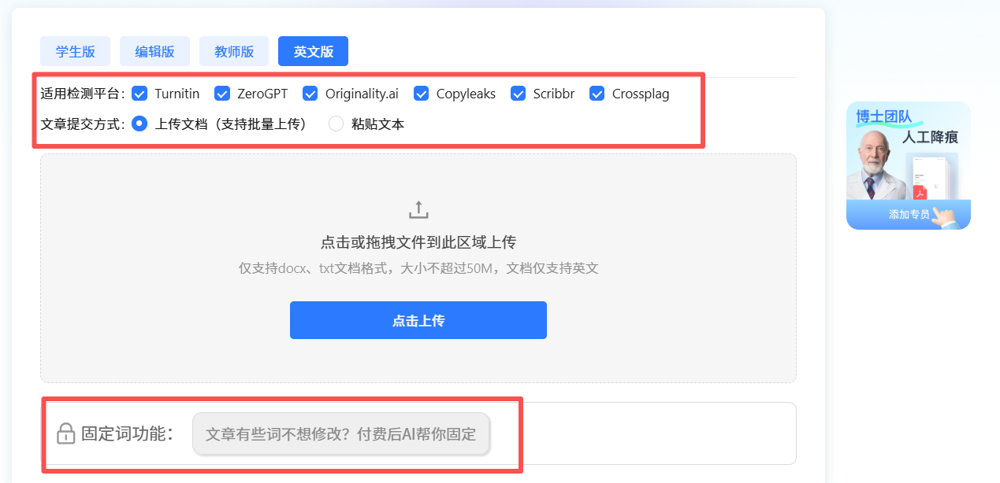

# 英文手写稿 AI 率太高？实测英文降 ai 率，帮你避开Turnitin误判大坑！

2026年新版**turnitin**持续更新后，不少留学生发现，自己手动完成的课程报告和 Essay，做**英文 ai 率检测**时也可能出现 AI 标记。我之前也用 **ZeroGPT、Copyleaks、Originality、AI Detector** 等**AI Checker**交叉检测，发现不同平台的结果并不完全一致。为了做好**英文降ai率**，我试过不少**英文 aigc 检测免费**网站和改写工具，但很多只是简单替换词汇，改完反而读起来生硬。后来我发现，与其一味追求检测数字，不如先检查文章结构、语言表达和论证逻辑。这篇就分享一些我的实际经验，供大家参考～

## 一、被标记 AI，不代表论文质量不合格

看到检测报告出现 **AI 标记**，很多同学的第一反应就是推翻全文、重新改写。其实不用急着大改。**Turnitin** 的 AI 检测与传统文字查重不同，但检测结果也可能存在误判，不能仅凭一个百分比就认定文章由** AI 生成**。

留学生写学术英文时，通常会注重语法规范、逻辑连贯和表达严谨。如果过度追求固定句式，文章读起来可能比较刻板，但这并不能直接证明使用了 AI。

网上常见的批量替换同义词、调整语序等方法，也不一定能改善文章质量，反而可能破坏原有的论证逻辑。与其一味追求**英文降 ai 率**，不如检查表达是否准确、论证是否清晰，让 **Humanize AI** 润色回归语言优化本身。

如果遇到检测争议，建议保留写作草稿、文献笔记和修改记录，便于说明自己的创作过程。

## 二、多款工具横向对比：为什么我选择笔灵 AI

市面上的英文改写工具参差不齐，我前后实测十多个平台，发现很多工具的通病：改写之后口语化泛滥，丢掉学术正式感；或是仅做浅层同义词替换，复测依旧**高 AI 率**。** 笔灵 AI **是我对比下来，更贴合留学生学术写稿需求的工具，自用分享。 

传送门：[笔灵英文降ai ](https://ibiling.cn/paper-pass/english?from=githubywjiangai1009jw)[https://ibiling\.cn/paper\-pass/english](https://ibiling.cn/paper-pass/english?from=githubywjiangai1009jw)

拿我一篇市场方向课程报告举例，原始稿件**英文 ai 率检测**高达 92%，属于高危预警区间。使用笔灵 AI 做深度真人化改写之后，AI 率直接降到 7% 安全区间。之后我用**turnitin**、**ZeroGPT**、**Copyleaks**、**Originality**交叉复测，没有出现成片标蓝，真正完成**Humanize AI**。

它和普通洗稿工具最大的区别，不在于替换词语，而是整体重构句式节奏，打散 AI 固化模板。有几个点对留学生特别友好：

第一，可以锁定专业术语、实验数据、核心论点、文献引用，只优化模板感过重的语句，不会篡改论文研究内容，守住学术严谨； 

第二，支持 docx、txt 完整文档上传，表格、注释、原有排版全部保留，不用改完重新整理格式，赶 DDL 的时候节省大量时间； 

第三，改写之后字数波动很小，不会出现篇幅暴增或者大幅缩水，不用反复增删文字去凑学校 Essay 字数。 

同时模型持续跟进各大海外检测平台更新，适配 2026 各类检测规则，减少改完之后复测翻车的风险。

## 三、不要完全依赖工具，定稿两套实操流程要记牢

工具只是辅助手段，想要稳稳交稿，不能改写完就直接提交，两步自查必不可少。 

**1、自主复测校验：**改写结束，可以借助**免费在线查 ai 率英文**工具做一遍**英文 ai 率检测**，确认高危标蓝段落消失，AI 数值落到安全范围，再进入定稿环节。

**2、人工通读润色：**整篇完整读一遍，微调部分句子的衔接，加入一点点属于自己的写作习惯，进一步弱化机器改写带来的痕迹。

## 写在最后

2026 年**Turnitin**检测标准收紧，手写稿遭遇误判已经成为很多留学生的共同烦恼，没必要为此熬夜反复重写整篇文稿。合理借助工具完成**英文降 ai 率**优化，再配合人工简单校对，守护自己熬夜产出的原创成果，让每一篇作业都可以顺顺利利定稿提交。

